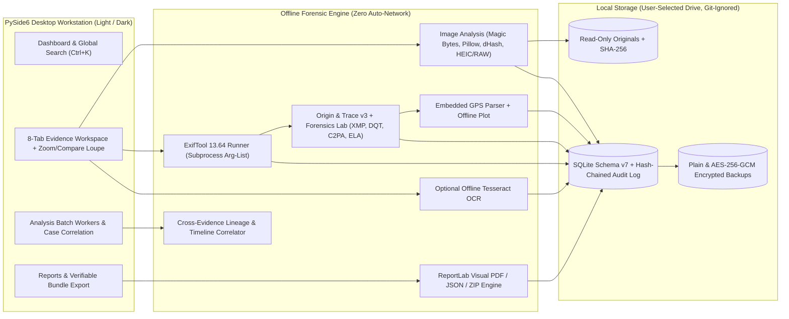
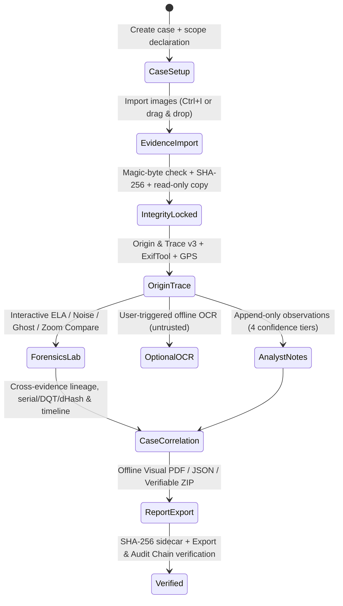

<div align="center">


# ImageTrace

**Local-first, offline digital image forensic examination workstation for Windows — built by [9va.net](https://9va.net)**

[](https://www.python.org/)
[](https://doc.qt.io/qtforpython-6/)
[](#security-posture)
[](#security-posture)
[](https://github.com/Novaaam/ImageTrace/releases)
[](./LICENSE)

[Overview](#overview) •
[Key Features](#key-features) •
[Architecture & Workflow](#architecture--workflow) •
[Quick Start](#quick-start) •
[Security Posture](#security-posture) •
[Commands & Shortcuts](#commands--shortcuts) •
[Project Structure](#project-structure) •
[Documentation](./docs/user-guide/getting-started.md)

</div>

---

## Overview

**ImageTrace** is a local-first Windows desktop workstation for examining digital image evidence with defensible chain-of-custody handling and honest separation between **Extracted facts**, **Automated results**, **Analyst observations**, and **Unverified hypotheses**.

Original evidence files are verified by magic bytes, hashed with streaming **SHA-256** before and after copying, stored under non-identifying IDs (`E-YYYYMMDD-XXXXXX.<ext>`), and marked **read-only**—never modified or uploaded. Every examination step (metadata extraction, multi-layer **Origin & Trace** provenance, embedded GPS checks, optional offline OCR, append-only analyst notes, case correlation, and report exports) is recorded in a hash-chained SQLite audit trail.

> [!IMPORTANT]
> **Ethical & Technical Scope Boundary:** ImageTrace is an **offline evidence examination tool**, not a person-tracking or deanonymization tool. Image files never contain IP addresses, router logs, or messaging-app forwarding chains. ImageTrace never identifies private individuals, performs facial recognition, reverse-geocodes residential addresses, or auto-uploads evidence to external websites.

---

## Key Features

The table below compares **ImageTrace** against ad-hoc CLI scripts and online EXIF/ELA websites:

| Capability | ImageTrace `v0.3.0` | Raw ExifTool CLI | Online EXIF / ELA Sites |
| :--- | :---: | :---: | :---: |
| **100% Offline Evidence Handling** | Yes (zero uploads) | Yes | No (uploads files) |
| **Read-Only Originals + SHA-256 Chain of Custody** | Built-in + hash-chained DB | Manual | None |
| **Origin & Trace (Mobile / Camera / Photoshop / AI / Stripped)** | 6-layer engine + timeline | Raw tags only | Basic tags |
| **Visual Forensics Lab (ELA, Noise, Gradient, Channels, JPEG Ghost)** | Interactive, pure Pillow | None | Fixed ELA only |
| **EXIF Thumbnail Mismatch + Side-by-Side Zoom Loupe (`25–800%`)** | Synchronized compare view | Manual extract | Rarely supported |
| **JPEG DQT Fingerprinting, MakerNotes IDs & Offline C2PA Claims** | Built-in | Partial | None |
| **HEIC (iPhone) & Camera RAW (`DNG`, `CR2`, `CR3`, `NEF`, `ARW`)** | Safe import + preview | Metadata only | Often unsupported |
| **Cross-Evidence Case Correlation & Chronological Timeline** | Lineage + Serial/DQT/dHash | None | None |
| **Offline Visual PDF, JSON & Verifiable `.zip` Case Bundles** | Validated + `.sha256` | None | None |
| **Encrypted Backups (`AES-256-GCM`) & Session Lock (`Ctrl+L`)** | Built-in | None | N/A |

> [!TIP]
> You can download the ready-to-run portable Windows release (`ImageTrace-v0.3.0-win64-portable.zip`) directly from **[GitHub Releases](https://github.com/Novaaam/ImageTrace/releases)** with zero Python setup required, or run directly from source with `requirements.bat` and `start.bat`.

---

## Architecture & Workflow

### System Architecture



### Examination Workflow & Lifecycle



---

## Quick Start

### Option A — Portable Windows Release (Easiest)

1. Download **`ImageTrace-v0.3.0-win64-portable.zip`** from **[Releases](https://github.com/Novaaam/ImageTrace/releases)** and extract it to a drive with ample free space (e.g. `D:\ImageTrace\`).
2. Double-click **`ImageTrace.exe`**.
3. On first launch, choose your case data folder (for example `D:\ImageTraceData\`). ImageTrace never silently writes case data to your C: drive or deletes it on uninstall.

### Option B — Run from Source (Windows 10/11, 64-bit)

#### Prerequisites
- **Python 3.11+** (64-bit)
- **ExifTool** (optional for basic import, recommended for full metadata/GPS/Origin & Trace — see below)

#### One-Click Setup & Launch
```bat
:: 1. Create venv\ and install pinned dependencies (keeps caches inside project folder)
requirements.bat

:: 2. Launch ImageTrace (windowed, no console)
start.bat

:: Optional: launch with console logs for troubleshooting
start.bat --console
```

<details>
<summary><strong>Optional External Tools (ExifTool & Tesseract OCR)</strong></summary>

<br>

- **ExifTool:** Place official Windows 64-bit ExifTool at `tools\third-party\exiftool\exiftool.exe` (or configure any path under **Settings → External tools**). See [`tools/third-party/README.md`](./tools/third-party/README.md).
- **Tesseract OCR (optional, user-triggered only):** Install locally and configure its executable & `tessdata` path in **Settings → External tools**. See [`docs/user-guide/ocr-setup.md`](./docs/user-guide/ocr-setup.md).

</details>

<details>
<summary><strong>Development, Testing & Portable Packaging</strong></summary>

<br>

```bat
:: Activate project venv with local TEMP / pip / ruff / PyInstaller caches
call tools\env.cmd

:: Environment health check (34 checks)
python tools\verify_env.py

:: Full automated test suite (291 tests, headless Qt)
python -m pytest

:: Lint, format & dependency vulnerability audit
ruff check . && ruff format --check . && pip-audit

:: Render light & dark UI screenshots using synthetic fixtures
python tools\screenshot.py

:: Build portable one-directory Windows executable (build\dist\ImageTrace\ImageTrace.exe)
python tools\build_portable.py
```

</details>

---

## Security Posture

- **Zero Automatic Network Calls:** Core workflows run 100% offline. Optional OpenStreetMap tile previews are **OFF by default** and require opt-in plus explicit disclosure; public reverse-image-search buttons only open the website homepage in your browser after disclosure confirmation—never uploading files.
- **Untrusted Input Isolation:** Strict magic-byte allowlist (rejects ZIP/RAR/7z, EXE/ELF, PDF, SVG/HTML/XML), decompression-bomb megapixel guards (`Image.MAX_IMAGE_PIXELS`), Windows reserved-device-name sanitization, `PlainText` enforcement on every Qt `QLabel`, and XML-escaped ReportLab PDF rendering.
- **Subprocess Hardening:** ExifTool and Tesseract are invoked strictly with argument lists (never `shell=True`), explicit timeouts, and Pillow-sanitized temporary inputs.
- **Authenticated Encrypted Backups & Session Lock:** Optional `.sqlite.itbak` backups use **AES-256-GCM + scrypt** with an authenticated 40-byte header and `.sha256` sidecar. Session lock (`Ctrl+L` + configurable idle timeout) masks the workspace and stores optional unlock passphrases solely as salted scrypt verifiers.
- **Append-Only Integrity Controls:** Hash-chained `audit_events`, SQLite `BEFORE DELETE` triggers on `notes` and `exports`, and `.sha256` sidecar verification on all exported reports and bundles.

> [!CAUTION]
> Never commit `data/`, `imagetrace.local.json`, or case backups to version control. Encrypted backup passphrases cannot be recovered if lost (no backdoor). See [`docs/user-guide/backup-recovery.md`](./docs/user-guide/backup-recovery.md).

---

## Commands & Shortcuts

### Keyboard Shortcuts

| Shortcut | Action |
| :---: | :--- |
| `Ctrl+1` … `Ctrl+7` | Navigate sidebar pages (`Dashboard` → `About`) |
| `Ctrl+N` | Create a new case (on Cases page) |
| `Ctrl+I` | Import evidence images (on Evidence page) |
| `Ctrl+K` | Open **Global Offline Search** across Cases, Evidence, Origin & Trace, Metadata, OCR & Notes |
| `Ctrl+L` | Lock session privacy screen immediately |
| `F5` | Refresh current screen |

### Helper Scripts

| Script | Description |
| :--- | :--- |
| `requirements.bat` | Creates `venv\` and installs pinned runtime & dev dependencies. |
| `start.bat` | Launches ImageTrace from the local `venv\` (`--console` for debug output). |
| `tools\build_portable.py` | Packages standalone one-dir `ImageTrace.exe` with LGPL dynamic Qt DLLs & `MANIFEST.sha256`. |
| `tools\Uninstall-KeepData.cmd` | Safely removes portable program files while preserving `data\` and user config. |

---

## Project Structure

```text
ImageTrace/
├── app/
│   ├── resources/                  # 9VA icons, badges & theme check SVGs
│   ├── src/imagetrace/
│   │   ├── app.py                  # Entry point, Windows AppUserModelID & startup flow
│   │   ├── db.py                   # SQLite schema v7, pre-migration backups & triggers
│   │   ├── audit.py                # Hash-chained append-only audit log + verifier
│   │   ├── cases.py                # Case repository (create, edit, archive, reopen)
│   │   ├── evidence.py             # Read-only evidence storage, SHA-256 & duplicate guard
│   │   ├── image_analysis.py       # Magic bytes, Pillow, dHash, HEIC/RAW ExifTool previews
│   │   ├── metadata.py             # Safe ExifTool subprocess runner & discrepancy checks
│   │   ├── provenance.py           # 6-layer Origin & Trace engine (v3.0)
│   │   ├── forensics.py            # DQT fingerprint, C2PA claims, ELA/Noise/Ghost/Extractors
│   │   ├── gps.py                  # Embedded GPS parser, validator & opt-in tile math
│   │   ├── ocr.py                  # Optional offline Tesseract CLI integration
│   │   ├── notes.py                # Append-only analyst notes with 4 confidence tiers
│   │   ├── correlation.py          # Cross-evidence lineage, clusters, timeline & search
│   │   ├── reports.py              # Offline Visual PDF, JSON & verifiable ZIP bundles
│   │   ├── backup.py               # Plain & AES-256-GCM encrypted backup + recovery
│   │   ├── security.py             # Salted scrypt verifiers & filename hardening
│   │   └── ui/                     # PySide6 pages, 8 evidence tabs, Zoom Viewer & dialogs
│   └── tests/                      # 291 automated unit, GUI, security & packaging tests
├── docs/
│   ├── architecture/               # Dependency & license review
│   ├── security/                   # Threat model & Phase 9 security audit
│   ├── test-reports/               # Phase & release verification reports
│   └── user-guide/                 # Getting started, backup recovery & OCR setup guides
├── tools/                          # Env helpers, verifier, screenshot harness & packager
├── LICENSE                         # MIT License (9va / 9va.net)
├── THIRD_PARTY_LICENSES.txt        # Full third-party license notices (LGPL-3.0, MIT, BSD, etc.)
├── RELEASE_NOTES.md                # Release highlights & known limitations
├── CHANGELOG.md                    # Keep-a-Changelog version history
├── requirements.txt                # Pinned runtime dependencies
├── requirements-dev.txt            # Pinned developer & packaging dependencies
├── requirements.bat                # One-click Windows environment bootstrapper
└── start.bat                       # One-click Windows application launcher
```

---

## Further Documentation

- **[Getting Started Guide (`docs/user-guide/getting-started.md`)](./docs/user-guide/getting-started.md)** — Installation, examination workflow, forensics lab, and safe uninstall.
- **[Backup & Recovery Guide (`docs/user-guide/backup-recovery.md`)](./docs/user-guide/backup-recovery.md)** — Encrypted `.sqlite.itbak` format, standalone decryption, and corrupt-DB recovery.
- **[Offline OCR Setup (`docs/user-guide/ocr-setup.md`)](./docs/user-guide/ocr-setup.md)** — Installing optional Tesseract OCR and language packs offline.
- **[Security Model (`docs/security/security-model.md`)](./docs/security/security-model.md)** — Threat model, trust boundaries, and security audit findings.
- **[Release Notes (`RELEASE_NOTES.md`)](./RELEASE_NOTES.md)** & **[Changelog (`CHANGELOG.md`)](./CHANGELOG.md)** — Full feature history (`v0.1.0` → `v0.3.0`).
- **[Third-Party Licenses (`THIRD_PARTY_LICENSES.txt`)](./THIRD_PARTY_LICENSES.txt)** — Complete attributions for bundled/linked libraries.
